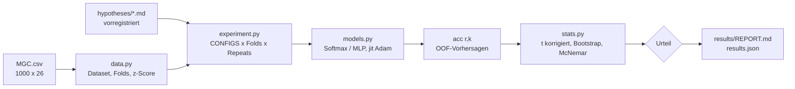

# research: Experten-Skill für hypothesengetriebene Experimente (JAX)

Ein reproduzierbarer Forschungszyklus auf den GTZAN-Features aus `MGC.csv`:

```
analysieren -> Hypothese aufstellen -> Experiment -> belegen / widerlegen -> dokumentieren
```

Jeder Schritt hat einen festen Ort im Repo. Nichts wird nachträglich an die Ergebnisse angepasst.

| Schritt | Ort | Inhalt |
|---|---|---|
| Analysieren | `mgc_jax/data.py` | Laden, Featuresets, stratifizierte Folds, Standardisierung ohne Leakage |
| Hypothese | `hypotheses/*.md` | Vorregistrierung: Frage, H1/H0, Metrik, Entscheidungsregel, Fehlerquellen |
| Experiment | `experiment.py`, `mgc_jax/models.py` | Konfigurationen, wiederholte k-fache CV, reine JAX-Modelle mit Adam |
| Belegen / Widerlegen | `mgc_jax/stats.py` | Korrigierter t-Test (Nadeau-Bengio), Bootstrap-CI, McNemar, Urteil |
| Dokumentieren | `results/REPORT.md`, `results/results.json` | Bericht mit Urteil je Hypothese, Konfusion, Umgebung, Befehl |
| Absichern | `tests/`, `.github/workflows/research.yml` | 16 Tests, CI mit Rauchtest-Experiment als Artefakt |

## Schnellstart

```bash
cd research
pip install -r requirements.txt     # jax[cpu], numpy, scipy, pytest
make test                           # Tests, ca. 10 s auf CPU
make quick                          # Rauchtest: 1 x 3-fold, 60 Schritte, ca. 15 s
make run                            # Vollauf: 5 x 10-fold, 600 Schritte, ca. 3 min auf 4 CPU-Kernen
```

Ergebnis: `results/REPORT.md` und `results/results.json`.

## Architektur



## Konfigurationen und Hypothesen

Vier Konfigurationen in `experiment.py`, Kreuzprodukt aus Featureset und Modellfamilie:

| Name | Features | Modell |
|---|---|---|
| softmax_all | 26 (6 spektral + 20 MFCC) | Softmax-Regression |
| mlp_all | 26 | MLP 128-64, ReLU |
| softmax_mfcc | 20 MFCC | Softmax-Regression |
| mlp_mfcc | 20 MFCC | MLP 128-64, ReLU |

Drei vorregistrierte Hypothesen, jede als gepaarter Vergleich a gegen b auf identischen Folds:

- H1: mlp_all > softmax_all. Nichtlinearität nötig?
- H2: mlp_all > mlp_mfcc. Spektrale Features nützlich (MLP)?
- H3: softmax_all > softmax_mfcc. Spektrale Features nützlich (Softmax)?

## Entscheidungsregel

Vor dem ersten Lauf festgelegt, danach unverändert:

1. Metrik: Accuracy je Fold, 5 x 10-fold stratifiziert, gleiche Folds für a und b.
2. Korrigierter t-Test nach Nadeau und Bengio (2003) auf den 50 gepaarten Differenzen. Die Korrektur
   (1/J + n_test/n_train) kompensiert die Abhängigkeit überlappender Trainingsfolds. Der naive t-Test wird
   nur zum Vergleich ausgegeben.
3. 95%-Perzentil-Bootstrap-CI des Mittelwerts der Differenzen.
4. McNemar auf den Out-of-Fold-Vorhersagen einer Wiederholung als fold-unabhängige Kontrolle.
5. Urteil: BELEGT bei p_korrigiert < 0.05 und CI > 0. WIDERLEGT bei CI < 0. NICHT BELEGT, wenn das CI die 0
   enthält. Keine Nachjustierung von alpha oder Metrik nach dem Lauf.

## Neue Hypothese hinzufügen

1. `hypotheses/TEMPLATE.md` kopieren und ausfüllen. Entscheidungsregel vor dem Lauf fixieren.
2. Konfigurationen in `CONFIGS` ergänzen (Featureset, hidden, lr, l2).
3. Eintrag in `HYPOTHESES` mit `a`, `b`, `title`. Behauptung ist immer accuracy(a) > accuracy(b).
4. `make test && make run`. Das Urteil steht in `results/REPORT.md`. Status in der Hypothesendatei nachtragen.

## Warum reines JAX

`models.py` kommt ohne Flax und Optax aus: Parameter sind Listen von (W, b), Adam ist in 15 Zeilen implementiert,
der Trainingsschritt ist mit `jax.jit` kompiliert und wird über alle Folds wiederverwendet, weil die Formen gleich
bleiben. Ein Fold trainiert in unter einer Sekunde auf CPU. Für GPU reicht `pip install jax[cuda12]`, der Code bleibt
gleich.

## Einschränkungen und nächste Schritte

- GTZAN hat bekannte Duplikate und Fehllabels (Sturm 2013). Absolute Accuracy ist nicht übertragbar, die gepaarten
  Vergleiche innerhalb des Datensatzes bleiben aussagekräftig.
- Features sind Clip-Mittelwerte über 30 s. Zeitliche Struktur fehlt. Nächster Schritt: Mel-Spektrogramm-Frames
  als Sequenz (siehe `MusicGenreClassification_melspectrogram.ipynb`) mit einem 1D-CNN in JAX, gleiche Statistik.
- Hyperparameter sind fix. Nächster Schritt: innere CV je Konfiguration, damit ein Vergleich nicht an der Wahl von
  lr oder l2 hängt.
- Mehrfachtests: drei Hypothesen bei alpha 0.05. Bei mehr Hypothesen Holm-Korrektur in `stats.py` ergänzen.
