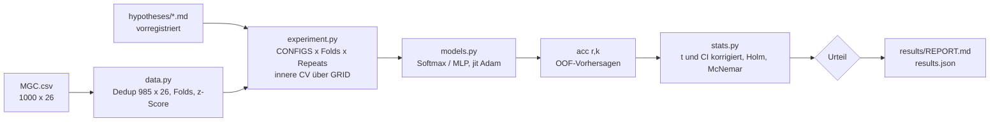

# research: Experten-Skill für hypothesengetriebene Experimente (JAX)

Ein reproduzierbarer Forschungszyklus auf den GTZAN-Features aus `MGC.csv`:

```
analysieren -> Hypothese aufstellen -> Experiment -> belegen / widerlegen -> dokumentieren
```

Jeder Schritt hat einen festen Ort im Repo. Nichts wird nachträglich an die Ergebnisse angepasst.

| Schritt | Ort | Inhalt |
|---|---|---|
| Analysieren | `mgc_jax/data.py` | Laden, Deduplizierung, Featuresets, stratifizierte Folds, Standardisierung ohne Leakage |
| Hypothese | `hypotheses/*.md` | Vorregistrierung: Frage, H1/H0, Metrik, Entscheidungsregel, Fehlerquellen |
| Experiment | `experiment.py`, `mgc_jax/models.py` | Konfigurationen, wiederholte k-fache CV mit innerer CV für lr und l2, reine JAX-Modelle mit Adam |
| Belegen / Widerlegen | `mgc_jax/stats.py` | Korrigierter t-Test und korrigiertes CI (Nadeau-Bengio), Holm-Korrektur, McNemar, Urteil |
| Dokumentieren | `results/REPORT.md`, `results/results.json` | Bericht mit Urteil je Hypothese, Konfusion, Umgebung, Befehl |
| Absichern | `tests/`, `.github/workflows/research.yml` | 24 Tests, CI mit Rauchtest-Experiment als Artefakt |

## Schnellstart

```bash
cd research
pip install -r requirements.txt     # jax[cpu], numpy, scipy, pytest
make test                           # Tests, ca. 25 s auf CPU
make quick                          # Rauchtest: 1 x 3-fold, 60 Schritte, innere 2-fold CV, ca. 30 s
make run                            # Vollauf: 5 x 10-fold, 600 Schritte, innere 3-fold CV, ca. 25 min auf 4 CPU-Kernen
python experiment.py --no-tune      # Vollauf mit festen lr/l2 aus CONFIGS, ca. 3 min
```

Ergebnis: `results/REPORT.md` und `results/results.json`.

## Architektur



## Konfigurationen und Hypothesen

Vier Konfigurationen in `experiment.py`, Kreuzprodukt aus Featureset und Modellfamilie:

| Name | Features | Modell |
|---|---|---|
| softmax_all | 26 (6 spektral + 20 MFCC) | Softmax-Regression |
| mlp_all | 26 | MLP 128-64, ReLU |
| softmax_mfcc | 20 MFCC | Softmax-Regression |
| mlp_mfcc | 20 MFCC | MLP 128-64, ReLU |

Drei vorregistrierte Hypothesen, jede als gepaarter Vergleich a gegen b auf identischen Folds:

- H1: mlp_all > softmax_all. Nichtlinearität nötig?
- H2: mlp_all > mlp_mfcc. Spektrale Features nützlich (MLP)?
- H3: softmax_all > softmax_mfcc. Spektrale Features nützlich (Softmax)?

## Entscheidungsregel

Vor dem ersten Lauf festgelegt, danach unverändert:

1. Daten: exakte Feature-Duplikate werden beim Laden entfernt (erstes Vorkommen bleibt), Duplikatgruppen mit
   widersprüchlichem Label komplett. Aus 1000 Clips werden 985 (13 Kopien, 2 Clips mit Label-Konflikt). Ohne diesen
   Schritt könnten Kopien desselben Clips in Trainings- und Testfold liegen.
2. Metrik: Accuracy je Fold, 5 x 10-fold stratifiziert, gleiche Folds für a und b.
   Hyperparameter lr und l2 werden je Outer-Fold und Konfiguration per innerer 3-fold CV auf dem Trainingsfold aus
   einem festen Gitter (3 Lernraten x 2 L2-Stärken, `GRID`) gewählt. Der Testfold wird beim Tuning nie berührt.
   Architektur und Schrittzahl bleiben fix.
3. Korrigierter t-Test nach Nadeau und Bengio (2003) auf den 50 gepaarten Differenzen. Die Korrektur
   (1/J + n_test/n_train) kompensiert die Abhängigkeit überlappender Trainingsfolds. Das 95%-CI wird aus derselben
   korrigierten Varianz gebildet. Naiver t-Test und unkorrigiertes Bootstrap-CI werden nur zur Information ausgegeben.
4. McNemar auf den Out-of-Fold-Vorhersagen einer Wiederholung als fold-unabhängige Kontrolle.
5. Mehrfachtests: die korrigierten p-Werte aller Hypothesen eines Laufs werden nach Holm-Bonferroni adjustiert
   (familienweise Fehlerrate 0.05).
6. Urteil, symmetrisch: BELEGT bei p_Holm < 0.05 und korrigiertem CI > 0. WIDERLEGT bei p_Holm < 0.05 und
   korrigiertem CI < 0. Sonst NICHT BELEGT. Konstante Differenzen ohne Streuung: keine Differenz ergibt p = 1.
   Keine Nachjustierung von alpha oder Metrik nach dem Lauf.

## Neue Hypothese hinzufügen

1. `hypotheses/TEMPLATE.md` kopieren und ausfüllen. Entscheidungsregel vor dem Lauf fixieren.
2. Konfigurationen in `CONFIGS` ergänzen (Featureset, hidden; lr und l2 sind nur der Fallback für `--no-tune`).
3. Eintrag in `HYPOTHESES` mit `a`, `b`, `title`. Behauptung ist immer accuracy(a) > accuracy(b).
4. `make test && make run`. Das Urteil steht in `results/REPORT.md`. Status in der Hypothesendatei nachtragen.

## Warum reines JAX

`models.py` kommt ohne Flax und Optax aus: Parameter sind Listen von (W, b), Adam ist in 15 Zeilen implementiert,
der Trainingsschritt ist mit `jax.jit` kompiliert und wird über alle Folds wiederverwendet, weil die Formen gleich
bleiben. Ein Fold trainiert in unter einer Sekunde auf CPU. Für GPU reicht `pip install jax[cuda12]`, der Code bleibt
gleich.

## Einschränkungen und nächste Schritte

- GTZAN hat bekannte Duplikate und Fehllabels (Sturm 2013). Exakte Duplikate sind entfernt, nahezu identische Clips
  und Fehllabels nicht. Absolute Accuracy ist nicht übertragbar, die gepaarten Vergleiche innerhalb des Datensatzes
  bleiben aussagekräftig.
- Features sind Clip-Mittelwerte über 30 s. Zeitliche Struktur fehlt. Nächster Schritt: Mel-Spektrogramm-Frames
  als Sequenz (siehe `MusicGenreClassification_melspectrogram.ipynb`) mit einem 1D-CNN in JAX, gleiche Statistik.
- Das Gitter ist klein. Softmax wählt in allen Outer-Folds die grösste Lernrate 0.01, also den Gitterrand; ein
  erweitertes Gitter (lr 0.03, mehr Schritte) könnte das lineare Modell weiter verbessern und H1 verkleinern.
- Getunt werden nur lr und l2. Hidden-Grössen, Schrittzahl und Batchgrösse sind fix; ein Vergleich der
  Architekturen selbst (H1) hängt also noch an diesen Festlegungen.
- Holm kontrolliert die familienweise Fehlerrate konservativ. Bei vielen Hypothesen pro Lauf ist Benjamini-Hochberg
  (FDR) die weniger strenge Alternative.
